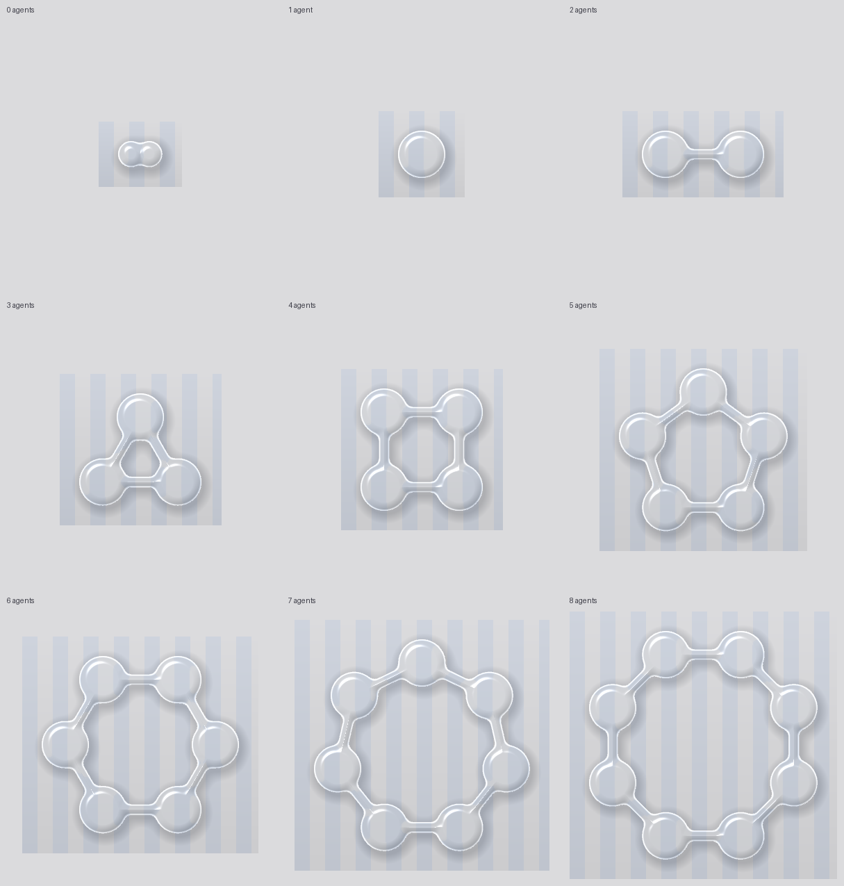

# Corral

  

**A free, open source pool of liquid glass on your Mac desktop that holds all your AI agents. Deploy them, watch them work, and approve what they do, all from one place.**



## Why Corral?

If you use more than one AI agent, you know the sprawl: a terminal for Claude Code, a tab for Grok, another app for something else, and an API dashboard to find out what it all cost. Each one has its own approvals, its own history and its own idea of what "done" means.

- **One place:** every agent you use lives in one corral at the bottom of your screen
- **You decide:** anything that sends, posts, deletes, runs a command or spends past your limit stops and asks you first
- **Private:** keys stay in your macOS Keychain, history stays on your Mac, and nothing goes anywhere except the providers you chose
- **Open source:** you can read every line that touches your keys and approves your agents' actions

Corral doesn't build agents. It's a calm place to keep the ones you already have, and the code should be simple enough to read in an afternoon.

## How It Works

1. **Pick:** click a drop in the corral (or ⌘-click several, or deploy them all)
2. **Prompt:** type the task, or hold the push-to-talk key and say it. Transcription happens on your Mac
3. **Watch:** the drop pinches off and becomes a live activity card showing the current step, tool, time and spend
4. **Decide:** risky actions pause at a checkpoint: approve, deny, edit the arguments, or allow for this run
5. **Return or re-task:** send the agent back to the corral, or give it another task with its context kept

### The corral

Each agent is a drop of glass. The corral's shape tells you how many agents are home:

| Agents | Shape |
|---|---|
| 1 | Circle |
| 2 | Dumbbell |
| 3 | Triangle |
| 4 | Square |
| 5–8 | Pentagon through octagon |

The corral shows at most 8 drops. If you have more agents, you choose which 8 show, and the rest stay one `@` away in the prompt bar. Your **most-used agent sits top-left**, the rest follow clockwise, and drops quietly slide around the ring as your habits change.

Try it now, no build needed: open [`native/CorralNative/preview/corral-shape-preview.html`](native/CorralNative/preview/corral-shape-preview.html) in a browser.

## Status

**Corral is in the planning stage. There is nothing to install yet.** In the spirit of being upfront, here is where things stand:

- ✅ Product brief, system design, security model, build plan, test plan and evals are written (see [Docs](#docs))
- ✅ The corral's shape and ordering maths are prototyped and checked with renders
- ⚠️ The Swift and Metal code in `native/` has **not been compiled yet**. Compiling it is the first task of Spike S5
- ⏳ The Rust core, adapters and app shell start at milestone M0

### Known limitations (by design or by circumstance)

- **macOS 26 or later only.** Corral uses Apple's Liquid Glass, so older macOS versions won't be supported
- **Consumer Muse and ChatGPT dots can't be controlled.** Neither Meta nor OpenAI offers an official API for driving them. Corral can run agents on the same model families through their developer APIs (the Meta Model API and the OpenAI Agents API), and shows the consumer apps as open-in-app links. Corral will **never** use unofficial wrappers or shared passwords to get around this
- **Provider-side tools** (such as xAI's server-side web search) run on the provider's servers, where Corral can't pause individual calls. You allow or block them before a task starts
- **No Screen Recording, ever.** The glass gets its look from Apple's system material, not from capturing your screen

## Supported Agents (planned for v1)

| Agent | How Corral connects |
|---|---|
| **xAI Grok** | Your API key; Corral runs the agent loop (OpenAI-compatible Responses API) |
| **Meta Muse Spark** | Your Meta Model API key; Corral runs the agent loop |
| **Anthropic Claude** | Your API key; Corral runs the agent loop |
| **OpenAI Agents API** | Your API key; OpenAI runs the loop, Corral supervises |
| **Claude Code, Codex CLI, Gemini CLI** and other local CLI agents | Spawned on your Mac over the [Agent Client Protocol](https://agentclientprotocol.com) |
| **Your own agents** | A `corral-agent.toml` file: persona, model, tools, permissions, budget |

## Quick Start

### Installation

Not yet available. v1.0 will ship as a signed, notarized download from GitHub Releases and as a Homebrew cask.

### Development Setup

Once milestone M0 lands, you'll need:

- macOS 26 and Xcode 26
- Rust (stable), Node.js with pnpm, and [`just`](https://github.com/casey/just)

```bash
just check        # format, lint, typecheck, tests, safety evals: run before every push
just dev          # run the app
just native-test  # Swift tests for the corral (shape grammar, ordering, render snapshots)
```

## Architecture

Corral is a [Tauri 2](https://tauri.app) app with three layers. One rule holds everything together: **every decision lives in the Rust core.** The interfaces only display state and send your intents back.

| Layer | Built with | Owns |
|---|---|---|
| **Core** | Rust | Agent lifecycle, the policy engine that decides what needs your approval, budgets, the event log, Keychain access, voice transcription |
| **Corral and cards** | Swift + Metal | The liquid-glass corral, activity and checkpoint cards, notifications, Touch ID |
| **Main window** | React + TypeScript | Trace viewer, agent and policy editors, spend, settings |

Core pieces (planned):

- **Policy engine:** pure and deny-by-default. Every side effect needs a permission token from it, and adapters can't skip it
- **Event log:** an append-only, hash-chained SQLite log. Cards, traces and spend are all views of it, and edits to the record are detectable
- **Adapters:** one interface for every kind of agent (native API loop, managed APIs, ACP for CLI agents, and later A2A for remote agents)
- **Traces:** exportable in the [OpenTelemetry GenAI](https://opentelemetry.io/docs/specs/semconv/gen-ai/) format, opt-in
- **Voice:** on-device speech-to-text following the approach of [Handy](https://github.com/cjpais/Handy)

```
corral/
├─ crates/              # Rust core: lifecycle, policy, store, adapters, tools, voice, evals
├─ apps/desktop/        # Tauri shell + React main window
├─ native/CorralNative/ # Swift + Metal: the liquid-glass corral, glass cards
├─ evals/               # Safety, cost and control scenarios
└─ docs/                # Everything below
```

## Safety Defaults

Out of the box, no agent can send, post, buy, delete or run a shell command without asking you. Each agent gets its own sandbox folder (`~/Corral/<Agent>/`) and spending limits (per task $1, per month $25, $100 total; all editable). Voice can deploy and stop agents, but it can't approve a risky action, so a misheard word never sends an email. The full threat model is in [docs/02-security-model.md](docs/02-security-model.md).

## Docs

| Doc | What's in it |
|---|---|
| [Product brief](docs/00-product-brief.md) | Problem, users, scope, principles, success measures |
| [System design](docs/01-system-design.md) | Architecture, adapters, policy engine, event log, UI, voice, sync |
| [Security model](docs/02-security-model.md) | Threats, controls, defaults, protected code paths |
| [Build plan](docs/03-build-plan.md) | Milestones M0–M9, spikes, exit criteria |
| [Test plan](docs/04-test-plan.md) | Test-driven development contract, test catalog, release checklist |
| [Evals](docs/05-evals.md) | Safety, UX and cost evals, plus metrics for the build loop |
| [Loop engineering](docs/06-loop-engineering.md) | How coding agents and humans build this repo together |
| [Brand and corral surface](docs/07-brand-and-corral-surface.md) | The liquid-glass corral: shapes, ordering, shader, motion |

## Roadmap

| Milestone | What ships |
|---|---|
| M0 | Repo, CI, agent rules, app skeleton |
| M1–M2 | Core runtime, policy engine and checkpoints, proven against a scripted fake agent first |
| M3 | First real provider: xAI Grok |
| M4 | The liquid-glass corral, activity cards, main window |
| M5 | Anthropic, Meta Model API, OpenAI Agents API, CLI agents, custom agents |
| M6–M7 | Voice, Touch ID, notifications, Shortcuts |
| M8 | **v1.0:** signed release, Homebrew, onboarding |
| M9 | v1.1: end-to-end encrypted sync, remote agents (A2A) |

## How to Contribute

Most of Corral is written by coding agents working one issue at a time, and every change is reviewed by people before it merges. Human contributors are just as welcome and follow the same loop:

1. Read [`AGENTS.md`](AGENTS.md). It has the rules, and they apply to people too
2. Pick an issue labeled `ready`. Each one names the tests that define "done"
3. Commit those tests first, failing, then make them pass
4. Run `just check` and open a PR using the template
5. Changes to safety-critical code (policy, sandbox, budgets, CI) need a maintainer's review

**Found a security issue?** Please don't open a public issue. Report it privately through [GitHub Security Advisories](https://github.com/acaspx/corral-howdy/security/advisories/new).

## Acknowledgments

- [Handy](https://github.com/cjpais/Handy) by CJ Pais, the model for this project's approach to forkability, candor and on-device voice
- [Tauri](https://tauri.app), [Agent Client Protocol](https://agentclientprotocol.com), [OpenTelemetry GenAI conventions](https://opentelemetry.io/docs/specs/semconv/gen-ai/)
- Apple's Liquid Glass and SwiftUI Metal shaders

## License

MIT. See [LICENSE](LICENSE).

The MIT license covers the code. The **Corral name, logo and liquid-glass corral visual identity are not open source**. Forks are welcome, but please give yours its own name and look.
