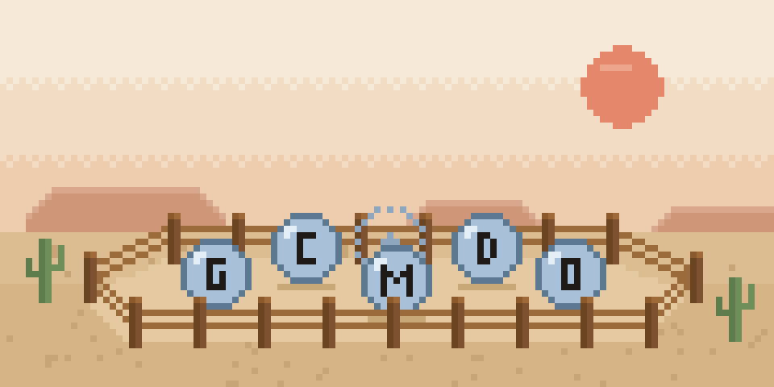

# Corral

  



**One corral on your Mac desktop for all your AI agents. Deploy them, watch them work, and approve what they do, from one place.**

If you use more than one agent, you know the sprawl: a terminal for Claude Code, a tab for Grok, another app for something else, and an API dashboard to find out what it all cost. Corral is a pool of liquid glass at the bottom of your screen that holds them all.

- **You decide.** Anything that sends, posts, deletes, runs a command or spends past your limit stops and asks first.
- **Private.** Keys stay in your Keychain and history stays on your Mac.
- **Open source.** Every line that touches your keys or approves an action is readable.

## How it works

1. **Pick** a drop in the corral, several, or all of them.
2. **Prompt** by typing, or hold the talk key and say it (transcribed on your Mac).
3. **Watch.** The agent stays in the corral and a column of cards rises above it: your prompt, the task, the current step. Hover the drop for progress, time and spend.
4. **Decide.** Risky actions pause. The drop pulses and its card shows exactly what the agent wants to do: Approve, Deny or Edit.
5. **Finish.** Read the result, ask a follow-up, or send the agent back.

The corral's shape is your headcount: one agent is a circle, two a dumbbell, three a triangle, up to an octagon at eight. Your most-used agent sits top-left. Each drop shows a logo you choose; Corral ships no third-party marks.


## Try it

Corral is in the planning stage and there's nothing to install yet. Two ways to see it today:

- **In a browser:** open [`native/CorralNative/preview/corral-shape-preview.html`](native/CorralNative/preview/corral-shape-preview.html) for shapes, hover cards, the trace tree and usage ordering.
- **On your desktop** (macOS 26, Xcode 26): run the real glass corral with fake agents. Steps in [`native/CorralNative/README.md`](native/CorralNative/README.md#try-it-on-your-desktop).

## Agents (planned for v1)

| Agent | How Corral connects | Corral can pause |
|---|---|---|
| xAI Grok, Anthropic Claude, Meta Muse Spark | Your API key; Corral runs the agent loop | Every tool call. Provider-side web search is allowed or blocked before the task starts |
| OpenAI Agents API | Your API key; OpenAI runs the loop | Every tool call, because Corral keeps OpenAI's hosted sandbox off by default ([why](docs/spikes/S3-provider-approval-hooks.md)) |
| Claude Code, Codex CLI, Gemini CLI | Run on your Mac over the [Agent Client Protocol](https://agentclientprotocol.com) | Edits and commands the CLI asks about |
| Your own agents | A `corral-agent.toml` file | Every tool call |
| Consumer Muse and ChatGPT dots | Open-in-app shortcuts only | Nothing: there's no official API, and Corral won't use unofficial ones |

## Safety defaults

No agent can send, post, buy, delete or run a command without asking. Each one gets its own sandbox folder and spending limits you can change. Voice can deploy and stop agents but can't approve a risky action. Corral never asks for Screen Recording. Details: [security model](docs/02-security-model.md).

## Status

- ✅ Docs: product brief, system design, security model, build plan, test plan, evals
- ✅ Rust workspace, Tauri + React shell, eval runner, hardened CI
- ✅ Swift + Metal corral builds on macOS 26; shape and ordering tests pass in CI
- ⏳ Next: a **walking skeleton**, one real agent (Grok) working live on the desktop through every layer, then tools, approvals and the full corral UI

What's next, in order, and the tests that define "done": [build plan › Next up](docs/03-build-plan.md#next-up-november-2026).

## Architecture

A [Tauri 2](https://tauri.app) app in three layers. **Every decision lives in the Rust core**; the interfaces show state and send your intents back.

| Layer | Built with | Owns |
|---|---|---|
| Core | Rust | Agent lifecycle, the deny-by-default policy engine, budgets, the hash-chained event log, Keychain access, voice |
| Corral and cards | Swift + Metal | The glass corral, hover cards, trace tree, notifications, Touch ID |
| Main window | React + TypeScript | Setup, trace viewer, agent and policy editors, spend, settings |

## Development

You'll need macOS 26, Xcode 26, Rust, Node.js with pnpm, and [`just`](https://github.com/casey/just).

```bash
just check        # format, lint, typecheck, tests and safety evals: run before every push
just dev          # run the app
just native-test  # Swift tests for the corral
```

## Docs

[Product brief](docs/00-product-brief.md) · [System design](docs/01-system-design.md) · [Security model](docs/02-security-model.md) · [Build plan](docs/03-build-plan.md) · [Test plan](docs/04-test-plan.md) · [Evals](docs/05-evals.md) · [Loop engineering](docs/06-loop-engineering.md) · [Brand and corral surface](docs/07-brand-and-corral-surface.md)

## Contributing

Most of Corral is written by coding agents, one issue at a time, and a person reviews every change. People follow the same loop:

1. Read [`AGENTS.md`](AGENTS.md); its rules apply to everyone.
2. Pick an issue labeled `ready`. It names the tests that define "done".
3. Commit those tests first, failing, then make them pass.
4. Run `just check` and open a PR with the template.

Changes to safety-critical code (policy, sandbox, budgets, CI) need the maintainer's review. Found a security issue? Report it privately through [GitHub Security Advisories](https://github.com/acaspx/Corral-howdy/security/advisories/new).

## Acknowledgments

- [Handy](https://github.com/cjpais/Handy) by CJ Pais, the model for this project's candor, forkability and on-device voice
- [Tauri](https://tauri.app), the [Agent Client Protocol](https://agentclientprotocol.com) and the [OpenTelemetry GenAI conventions](https://opentelemetry.io/docs/specs/semconv/gen-ai/)
- [Emil Kowalski](https://github.com/emilkowalski)'s [skills](https://github.com/emilkowalski/skills) (MIT), vendored in [`.claude/skills/`](.claude/skills/) so coding agents get animation and Apple-platform details right. More at [emilkowal.ski](https://emilkowal.ski)

## License

MIT. See [LICENSE](LICENSE). The license covers the code; the **Corral name, logo and visual identity** (including the glass corral and the 8-bit corral) are not open source. Forks are welcome under their own name and look.
