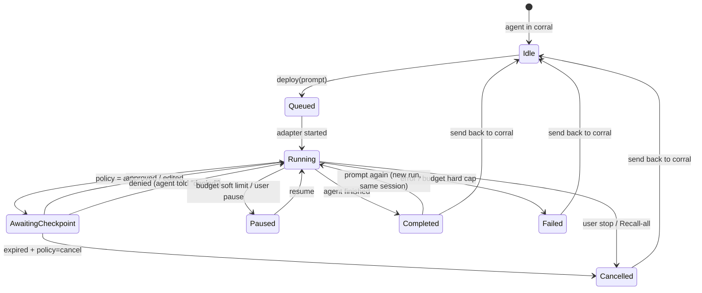

# Corral: System Design

Status: Draft v0.1 · Last updated: 2026-11-07
Read first: [00-product-brief.md](00-product-brief.md). Security details: [02-security-model.md](02-security-model.md).

---

## 1. Architecture at a glance

```
┌──────────────────────────── macOS ────────────────────────────┐
│                                                               │
│  ┌──────────── Corral.app (Tauri 2 bundle) ───────────────┐   │
│  │                                                        │   │
│  │  Webviews (React + TypeScript)                         │   │
│  │   └─ Main window: traces, agent config, policies,      │   │
│  │      spend, settings                                   │   │
│  │                                                        │   │
│  │            ▲ typed IPC (tauri-specta commands/events)  │   │
│  │            ▼                                           │   │
│  │  Tauri shell (thin): windows, tray, hotkeys, updater   │   │
│  │            │                                           │   │
│  │  ┌─────── corral-core (Rust, no UI deps) ─────────┐    │   │
│  │  │ Supervisor ── Run actors (1 tokio task per run)│    │   │
│  │  │   │             │                              │    │   │
│  │  │   │        Adapter trait ──┬─ native (API loop)│    │   │
│  │  │   │                        ├─ managed (Agents) │    │   │
│  │  │   │                        ├─ acp (CLI stdio)  │    │   │
│  │  │   │                        ├─ a2a (remote)v1.1 │    │   │
│  │  │   │                        └─ fake (tests)     │    │   │
│  │  │ Policy engine (pure) ◄── every action          │    │   │
│  │  │ Budget meter          Tool gateway (fs, MCP)   │    │   │
│  │  │ Event store (SQLite, append-only, hash-chained)│    │   │
│  │  │ Secrets (Keychain)    Voice (on-device STT)    │    │   │
│  │  └────────────────────────────────────────────────┘    │   │
│  │            │ C ABI via swift-rs                        │   │
│  │  CorralNative (Swift + Metal): liquid-glass corral,    │   │
│  │  hover cards, trace tree, notifications, Touch ID      │   │
│  └────────────────────────────────────────────────────────┘   │
│                       │ HTTPS (only to configured providers)  │
└───────────────────────┼───────────────────────────────────────┘
                        ▼
   xAI · OpenAI · Anthropic · Meta Model API · MCP servers · (opt-in) sync backend
```

**The rule that keeps this clean:** every decision lives in `corral-core`: lifecycle, policy, budgets, persistence. The UI and Swift layers only *display* and *collect input*. This makes the core fully testable headlessly and keeps safety logic in one audited place.

## 2. Stack decision (ADR-001)

**Tauri 2 + React/TypeScript UI + Rust core + a Swift/Metal layer (CorralNative) for the glanceable native surfaces.**

| Option | Pros | Cons | Verdict |
|---|---|---|---|
| Tauri 2 + React/TS | Matches Anton's React/TS; small binary; Rust core for process control, Keychain, SQLite; capability-based IPC permissions; proven for menu-bar apps (tray + positioner plugin) and by production apps like Handy | WebKit webview quirks; native macOS polish needs bridging | **Chosen** |
| Native SwiftUI only | Best macOS feel | Second language for most of the code; React/TS skills unused; no path to other OSes | Used for the glanceable surfaces (corral, cards) |
| Electron | Fastest prototype | Heavier, larger attack surface, Node in the main process | Rejected |

**Split by surface (amended for the liquid-glass brand, ADR-009):**
- **Swift + Metal (CorralNative)** owns everything you see at a glance: the liquid-glass corral at the bottom of the desktop (a custom Metal shader) with agent logos, the hover cards and checkpoint buttons, the trace tree, actionable notifications, Touch ID prompts for critical approvals, App Intents/Shortcuts, and later a WidgetKit widget.
- **React (webviews)** owns deep work: trace viewer, agent and policy editors, spend, settings.
- **Rust core** owns every decision. Swift and React only display state and send intents back.

Swift is linked through `swift-rs` behind a narrow C ABI carrying versioned JSON. **Spike S1** (done 2026-11-10) confirmed the bridge, notifications and Touch ID, and found the widget packaging feasible; the findings and the process-model decision are in [adr/001-stack.md](adr/001-stack.md). **Spike S5** compiles and tunes the corral shader. See [07-brand-and-corral-surface.md](07-brand-and-corral-surface.md).

## 3. Domain model

```
AgentDefinition ─┐          ┌─ Checkpoint (0..n per run)
  id, name,      │          │    action, risk, args, preview,
  adapter kind,  │   Run ───┤    status: open|approved|denied|expired
  provider/model,├─► id,    │
  persona, icon, │   agent_id, session_id, prompt, state,
  tools (MCP),   │   budget, spend, started/ended
  policy_profile,│          │
  budget         │          └─ Event (append-only, many per run)
Session ─────────┘              seq, ts, kind, payload, parent_span,
  conversation context            prev_hash, hash
  that survives runs
```

- **AgentDefinition**: what lives in the corral. Created from the UI or a `corral-agent.toml` manifest. `icon` is a reference to a logo image the user assigned, stored in Corral's own folder (see [07 §8.1](07-brand-and-corral-surface.md)).
- **Run**: one deployment on one task. "Prompt again" creates a new Run in the **same Session**, so context carries over. "Send back to corral" closes the Session.
- **Event**: the single source of truth (ADR-002). Run state, hover cards, the trace tree, traces and spend are all *projections* of the event log.
- **Checkpoint**: a pending human decision. It is itself recorded as events (`checkpoint.opened`, `checkpoint.resolved`).

### Run lifecycle



The state machine is a pure function `next(state, event) -> Result<state>` in `corral-core::lifecycle`, covered by property tests (see test plan). Illegal transitions are errors, never silent no-ops.

## 4. Adapter layer

Every agent kind implements one trait. The supervisor doesn't know or care which provider is behind it.

```rust
#[async_trait]
pub trait AgentAdapter: Send + Sync {
    fn kind(&self) -> AdapterKind;
    fn capabilities(&self) -> Capabilities; // streaming, tool hooks, cancel, resume…

    /// Start a run. The adapter streams normalized AgentEvents back.
    /// Before executing ANY side-effecting action it MUST call `gate.check(action)`
    /// and await the decision. Adapters cannot reach tools except through `gate`.
    async fn start(
        &self,
        ctx: RunContext,          // prompt, session history, model config
        gate: PolicyGate,         // policy + checkpoint channel + budget meter
        tools: ToolGateway,       // fs sandbox, MCP client, provider-tool toggles
        out: EventSink,
    ) -> Result<RunHandle>;

    async fn cancel(&self, run: &RunHandle) -> Result<()>;
}
```

| Adapter | Who runs the agent loop | Used for | Checkpoint mechanism |
|---|---|---|---|
| `native` (**primary**) | Corral | xAI Grok (Responses API), OpenAI-compatible endpoints, Anthropic Messages, Meta Model API (Muse Spark; it accepts the OpenAI and Anthropic SDK formats) | Full: Corral executes every local tool, so it gates every call |
| `managed` | Vendor | OpenAI Agents API | Function tools return to Corral (`requires_action`) and are fully gated. Sessions default to environment `none`, so every side effect is a Corral function tool. Hosted sandboxes and the hosted browser are opt-in, with partial gating (Spike S3) |
| `acp` | The CLI agent | Claude Code, Codex CLI, Gemini CLI, any ACP agent | ACP permission requests are mapped to Corral checkpoints. Corral is the ACP *client*. Gating is `Partial` unless Corral sets the agent's permission mode for the session, because a CLI agent's own settings can pre-approve tools (T22) |
| `a2a` (v1.1) | Remote agent | Agents exposing A2A v1.0 Agent Cards | A2A `input-required` task state → checkpoint |
| `custom` | Corral (compiles to `native`) | User manifests | Same as native |
| `fake` | Test script | Tests and evals | Scripted |
| `linked` | Vendor app | Consumer Muse, consumer dots | None. Not managed; open-in-app only |

**Provider-side tools** (e.g. xAI server-side web search, code execution) run on the vendor's servers, where Corral can't intercept individual calls. They are a separate permission (`provider_tools`) decided *before* the request, and the UI labels them "runs on xAI's servers".

**Gating rules from Spike S3** ([findings](spikes/S3-provider-approval-hooks.md)): only OpenAI's hosted MCP offers per-call approval for vendor-executed tools; xAI, Anthropic and Meta offer only up-front allowlists. So:
- **Corral connects MCP servers itself.** MCP always goes through Corral's own MCP client in the `ToolGateway`, never through a vendor-hosted MCP connector.
- **Tool results are capped** before they reach the model: 16 KB of text by default, per profile. The full output stays in the trace and the model sees a truncation marker (T30).
- **Read-only vendor tools** (web search) are a deploy-time `provider_tools` permission.
- **Side-effecting vendor tools** (code execution with network, hosted shells and sandboxes, the hosted browser) are off by default and high-risk to enable.
- **Adapters report a `gating` level** (`Full` / `Partial` / `PreflightOnly`) in `Capabilities`. A run below the agent profile's minimum (default `Full`) won't start.
- **Corral never enables vendor auto-approval** such as the Agents API's `auto_review`.
- **Launching a program is itself gated.** Starting an MCP server or an ACP agent command asks once per (path, SHA-256) as an `exec.shell`-class checkpoint; a changed binary asks again (T23). ACP agents run under a small reaper that kills their process group when Corral's pipe closes, so a crash can't orphan them (T26).

### Provider clients
`corral-adapters::providers` holds one thin client per wire format: `openai_responses`, `openai_chat` (legacy fallback), `anthropic_messages`. xAI and the Meta Model API reuse the OpenAI-compatible clients with a different base URL and key. Each client normalizes streaming deltas, tool calls and usage into `AgentEvent`s. Model IDs are config, never hard-coded. The clients share one driver (`stream.rs`: key at request time, budget admission, retries on 429, 503 and 529, idle timeout, Stop); each brings only its endpoint, headers, body and stream decoder. `anthropic_messages` sends the key in `x-api-key` with `anthropic-version: 2023-06-01`, and computes cost from tokens because Anthropic reports none (SK-7).

The first client, `corral_adapters::responses` (SK-4), speaks the OpenAI Responses format to xAI. It sends `store: false`, so conversations stay off xAI's servers. It reports the provider's billed cost (`usage.cost_in_usd_ticks`, 10^-10 USD, rounded up to micro-USD). It retries 429 and 503 up to three attempts in all, honoring `Retry-After`. It never repeats a provider's 401 message, which echoes part of the key. HTTPS goes through `reqwest` with `native-tls`, which is Security.framework on macOS: the system trust store and no bundled crypto. Tests replay cassettes (`tests/cassettes/xai/`). `cargo run -p corral-adapters --example record_xai` records real exchanges on a Mac, so the same tests also run against what xAI actually sends.

### Custom agent manifest

```toml
# ~/Library/Application Support/Corral/agents/scout.corral-agent.toml
name        = "Scout"
adapter     = "native"
provider    = "xai"                 # key resolved from Keychain item "corral.xai"
model       = "grok-4.5"            # user-editable; validated against provider /models
persona     = "You research topics and return cited summaries."
icon        = "scout.png"           # optional; relative to the manifest, copied in at import
provider_tools = ["web_search"]     # vendor-side; needs policy allow

[[mcp_servers]]
name    = "notes"
command = "/usr/local/bin/notes-mcp"
secrets = { NOTES_TOKEN = "keychain:notes-mcp" }   # names a Keychain item; never the value (T29)

[policy]
profile = "researcher"              # see policy profiles below

[budget]
per_run_usd   = 0.50
monthly_usd   = 20.00
```

The manifest is parsed with a strict schema (unknown keys are an error) and fuzzed (see test plan). Importing a manifest from someone else always shows a permissions summary before it's added.

## 5. Policy engine and checkpoints (ADR-003)

Pure, deterministic, deny-by-default. Input: `(agent policy profile, action, run context)`. Output: `Allow | Ask{risk, reason} | Deny{reason}`.

The run context includes `tainted`, which the core sets the first time a run takes in untrusted content (network reads, provider web search, responses from MCP servers the profile doesn't mark trusted, files read outside the sandbox roots). On a tainted run, allow-for-run grants on the classes that can send data out (`net.write`, `comms.send`, `net.read.unlisted`, `a2a`) don't apply: each action asks again. This breaks the "lethal trifecta" of private data, untrusted content and a way out within one run (T28).

**Action classes** (every adapter maps its actions to exactly one of these):

| Class | Examples | Default |
|---|---|---|
| `read.local` | read a file inside sandbox roots | allow |
| `read.local.outside` | read outside sandbox roots | ask |
| `write.local` | create or modify a file inside sandbox roots | ask (can be widened to allow) |
| `delete.local` | delete any file | ask (high) |
| `exec.shell` | run a command (ACP agents) | ask (high) |
| `net.read` | HTTP GET to an allowlisted domain | allow |
| `net.read.unlisted` | HTTP GET to an unlisted domain | ask |
| `net.write` | POST/PUT/DELETE, form submits, webhooks | ask (high) |
| `comms.send` | email, message, post | ask (high) |
| `money.spend` | purchases, payments | ask (critical, Touch ID) |
| `provider_tools` | vendor-side tools | decided at deploy |
| `budget.threshold` | run or month spend crosses soft limit | ask |
| `unknown` | anything not mapped | **deny** |

These defaults match the planning decisions. Outbound actions, file and shell actions, and budget thresholds all stop at a checkpoint, and every agent gets its own editable profile.

**Profile example:**

```toml
[profiles.researcher]
sandbox_roots   = ["~/Corral/Scout"]
net_allow       = ["*.wikipedia.org", "arxiv.org"]
rules = [
  { class = "write.local",  decision = "allow" },      # widened for this agent
  { class = "net.write",    decision = "deny"  },
  { class = "comms.send",   decision = "deny"  },
]
checkpoint_timeout = "30m"
on_timeout         = "deny"   # deny | cancel_run
```

**Checkpoint resolution options:** Approve once · Deny (with optional note sent to the agent) · Edit arguments then approve · Allow for the rest of this run. For normal-risk classes, allow-for-run covers the class. For high and critical classes it covers the class *and the destination* (same recipient, domain or path root), so one approval can't sweep through a later injected action (T21). "Allow forever" is *only* available in the policy editor, never one click away on a checkpoint. That keeps approval drift deliberate.

**Risk tiers → required gesture:**
- normal: click or keyboard
- high: click; voice cannot approve
- critical (`money.spend`, `delete.local` outside sandbox): Touch ID via CorralNative

## 6. Event store and traces (ADR-002)

- SQLite (WAL mode) at `~/Library/Application Support/Corral/corral.db`. Large payloads (tool outputs over 64 KB) go to content-addressed blobs next to it.
- Append-only `events` table: `(run_id, seq, ts, kind, span_id, parent_span_id, payload_json, prev_hash, hash)`. The hash chain makes after-the-fact edits detectable. To catch a *whole-log* rewrite, each run's final head hash is MACed with a key held only in the Keychain and verified on open (T24).
- Projections (`runs_view`, `spend_view`, `checkpoints_view`, `usage_rank`, `plan_view`) are rebuilt from events and can be dropped and regenerated at any time. A test proves the rebuild gives identical results.
- **Trace export** follows OpenTelemetry GenAI semantic conventions (`invoke_agent`, `chat`, `execute_tool` spans; `gen_ai.*` attributes). Those conventions are still marked *Development*, and in June 2026 they moved to a dedicated repository, so we **pin a version** in `corral-core::otel` and run a mapping test per version bump. Export is opt-in: OTLP to a user-specified endpoint (Langfuse, Phoenix, Jaeger) or a JSON file.
- Prompt and response content is stored locally only. Export redacts content unless the user explicitly enables it.

### Event kinds (v1)
`run.queued · run.started · plan.updated · model.request · model.delta · model.response · tool.requested · policy.decided · checkpoint.opened · checkpoint.resolved · tool.started · tool.result · usage.reported · budget.warned · run.paused · run.resumed · run.completed · run.failed · run.cancelled · session.closed`

## 7. Budgets

`BudgetMeter` sits in front of every model request. It estimates cost before the request (tokens × price table, which is config) and blocks if the request would cross a **hard cap**. Because output and reasoning tokens aren't known up front, every request also sets its max output tokens from the remaining budget, and per-call vendor tool fees are priced before the call (T25). When the provider reports usage, it reconciles to the real numbers. A **soft limit** raises a `budget.threshold` checkpoint. Caps exist per run, per agent per month, and globally. The price table is versioned config with a "last verified" date shown in the UI.

How the hard cap is enforced (SK-5, `corral-core/src/budget`): each run's `EventSink` holds the run's budget, and `model.request` can be logged only through `EventSink::request_model`, which asks the meter first. A request's worst case is its input (bounded before the call at one token per byte of the prompt, plus 256 tokens of overhead), its vendor tool fees, and its output limit. The meter refuses a request when even a 16-token answer wouldn't fit; otherwise the request carries the most output tokens the remaining budget pays for, up to the adapter's ceiling. Admitted requests that haven't reported usage count at their worst case. `usage.reported` replaces the reservation with the billed cost, or with tokens × price if the provider reports less, so spend is never under-counted. A refusal fails the run with `budget_hard_cap` and nothing is sent. Until agent manifests land, the per-run cap is one setting for every run ($1 by default).

## 8. Concurrency and the supervisor

- One tokio task (actor) per run, owning that run's state. Its mailbox receives `Cancel`, `Pause`, `CheckpointResolved`, `AdapterEvent`.
- The supervisor owns the actor registry and enforces global limits: max concurrent runs (default 8) and per-provider rate limits.
- **Recall-all** (global hotkey + menu item) broadcasts `Cancel` to every actor. Adapters must stop within 2 s or are force-dropped: ACP child processes are killed, HTTP streams are aborted. Covered by an eval.
- Crash safety: on launch, any run in `Running` without a terminal event is marked `Failed{reason: "app_restarted"}`. Runs are not auto-resumed in v1.
- **Process model (decided in Spike S1):** the Swift UI is linked in-process, so a UI crash would take the supervisor down. S1 decides between keeping one process (with hardened, bounded Swift input) and running the core as a separate helper process the UI talks to. Closing the main window never quits Corral; only Quit does.

## 9. UI surfaces

**Desktop form:** a liquid-glass corral at the bottom center of the desktop, a trace tree and hover cards above it, and a main window for deep work. Full spec: [07-brand-and-corral-surface.md](07-brand-and-corral-surface.md).

- **The corral (Swift + Metal):** each shown agent is a glass drop. Drops are joined by liquid bridges into a shape that encodes the count: circle, dumbbell, triangle, square, then polygons up to an octagon (8 is the maximum; with more agents the user chooses which show). The most-used agent sits top-left and the rest follow clockwise, re-ordered as usage changes. Each drop shows the agent's logo: for a provider agent, its provider's icon, fetched when the key is connected (ADR-015). **Working agents stay in the shape** (ADR-014); status shows as a ring and badge around the logo.
- **Hover cards (SwiftUI, paper material):** hovering or focusing a drop opens a card with the agent, its current task, segmented plan progress, elapsed and spend, the pending checkpoint's exact detail, and the buttons for its state (Approve / Deny / Edit…, Pause / Stop, Send back / New task, Trace ›).
- **Trace tree (SwiftUI, translucent cards):** one column per running task above the corral (max 3): prompt pill → task card → stack of subtask cards, wired into the agent's drop. Subtasks come from the `plan_view` projection: `plan.updated` events from the adapter (ACP plan updates, a native plan tool), or top-level trace spans when the agent publishes no plan.
- **Prompt bar:** slides up from the corral, with a mic button (push-to-talk) and "Deploy selected" / "Deploy all".
- **Menu-bar icon:** a fallback entry point (show corral, settings, quit).
- **Main window (deep work):** trace viewer (span tree plus waterfall, filter by kind, copy as JSON), agent editor, policy editor (shows the effective decision for each action class), spend dashboard, settings.
- **Notifications:** checkpoints raise an actionable notification (Approve / Deny / Open). High and critical risks open that agent's hover card above the corral instead of offering inline approve.
- **Global hotkeys (configurable):** summon corral + prompt bar, push-to-talk, Recall-all.
- Native state: Swift receives roster and run snapshots plus deltas from the core over the C ABI. For the corral, the core sends the shown agents in the corral (≤ 8), already sorted by `usage_rank`; Swift only maps rank → slot. A shared snapshot fixture format drives both SwiftUI previews and Storybook.
- **Agents from keys (TP-VIEW-06):** until manifests (M5), the corral holds one agent per connected provider (`corral_adapters::catalog`): Grok for xAI, Claude for Anthropic, GPT for OpenAI, Muse Spark for the Meta Model API. Connecting a key adds its drop; removing it takes the drop away. `AgentRouter` sends each run to its agent's provider client; an agent whose client hasn't landed yet ends its run with a plain message.
- **Run cards and controls (core, SK-6):** `corral_core::run_card` projects each drop's card from the log: status, elapsed time from `run.started` (stopping at the end), spend from `usage.reported`, the answer and any error as agent text (cleaned and capped by `corral_core::agent_text`, T20), and the buttons for its state (07 §8.2). The cards ride on the roster snapshot (`roster-cards-v1.json`), republished on every change and once a second while a clock is moving. `corral_core::controls` decides what a click does: deploy from a drop (a new session, or a follow-up in the open one), Stop, Send back (logs `session.closed`) and Retry (the failed prompt, same session). The shell only routes intents to it.
- **Usage ranking (core):** `usage_rank` scores each agent by deploys in the last 90 days with a 14-day half-life. Tie-breaks are most recent deploy, then creation order. New orders are published only when the corral reports idle, with 10% hysteresis between neighbors. Details: [07 §3.1](07-brand-and-corral-surface.md).
- Frontend state: TanStack Query for command results plus a per-run event subscription. Zustand for UI-only state. Every component has a story (Storybook) with fixture event streams.
- Accessibility: full keyboard path for deploy, approve and deny; VoiceOver labels on every status; never color-only status.

## 10. Voice

Push-to-talk → on-device transcription → text in the prompt bar (editable before send by default; "send on release" is an opt-in setting). Built on the same approach and crates as Handy (Whisper-family and Parakeet models, VAD), so audio never leaves the Mac. Voice can deploy, prompt, pause and stop. **It cannot approve high- or critical-risk checkpoints**, because misrecognition must never authorize an outbound action.

## 11. Secrets

API keys go in the macOS Keychain (one item per provider, access-controlled to the signed app; `corral-secrets`, items `corral.<provider>`, account `api-key`). They are never written to SQLite, logs, traces, manifests or sync. They're fetched just in time per request and zeroized after use. Settings show only the last 4 characters: the webview sends a key in through a command it must be granted, and gets back only a status (TP-SETUP-01). Keys come in through one field for any provider: the core suggests the provider from the key's prefix and the user can change it (TP-SETUP-05). Then the core checks the key by asking that provider for its model list, which spends no tokens (TP-SETUP-02). A refused key, or one that couldn't be checked because the provider was unreachable, is never stored; a provider with no known check yet (the Meta Model API) is stored and marked unchecked. ACP CLI agents receive keys through env vars only if the user maps them, and the mapping is shown in the agent's permission summary.

## 12. Optional sync (v1.1, ADR-006)

Local-first, with sync off by default. Because history is an append-only event log, sync is replication of encrypted event batches: per-device keys, a shared corral key wrapped per device, and ciphertext only on the server. The first backend is the user's own iCloud (CloudKit private database). An S3-compatible backend is a follow-up. **What never syncs:** API keys, Keychain items, raw blobs above a size limit unless opted in. Conflicts can't happen on events (append-only, `(device_id, seq)` keys). Agent definitions and policies use last-writer-wins with a visible conflict note.

## 13. Repository layout

```
corral/
├─ apps/desktop/
│  ├─ src/                 # React + TS (panel, main window, components, stories)
│  └─ src-tauri/           # thin Tauri shell: windows, tray, hotkeys, IPC wiring
├─ crates/
│  ├─ corral-core/         # domain types, lifecycle, supervisor, budget, otel mapping
│  ├─ corral-policy/       # pure policy engine + profiles
│  ├─ corral-store/        # SQLite event store + projections
│  ├─ corral-secrets/      # provider keys in the Keychain
│  ├─ corral-adapters/     # trait + native/managed/acp/a2a/fake + provider clients
│  ├─ corral-tools/        # tool gateway: fs sandbox, MCP client
│  ├─ corral-voice/        # STT (Handy-derived)
│  └─ corral-evals/        # eval runner + graders
├─ native/CorralNative/    # Swift + Metal: liquid-glass corral, hover cards, trace tree, Touch ID
├─ evals/                  # scenarios, injection corpus, golden traces
├─ docs/                   # these docs + ADRs
└─ .github/                # CI, templates, CODEOWNERS
```

## 14. Decision log

| ADR | Decision | Status |
|---|---|---|
| 001 | Tauri 2 + React/TS + Rust core + Swift native package; C ABI with versioned JSON; core in-process for v1 | **Accepted** 2026-11-10 ([adr/001-stack.md](adr/001-stack.md)) |
| 002 | Event-sourced, hash-chained run log; all views are projections | Proposed |
| 003 | Policy in Rust core, pure and deny-by-default; adapters can't bypass the gate | Proposed |
| 004 | Native API runner is the primary adapter | Proposed |
| 005 | No unofficial wrappers for consumer agents (Muse, dots); "linked app" until official APIs exist | Proposed |
| 006 | Local-first; opt-in E2E-encrypted event replication for sync | Proposed |
| 007 | Trace export uses a pinned version of the OTel GenAI conventions | Proposed |
| 008 | Voice cannot approve high/critical checkpoints | Proposed |
| 009 | Glanceable surfaces (corral, cards, checkpoints) are native SwiftUI + a custom Metal liquid-glass shader; deep-work surfaces are React | Proposed (confirm after Spike S5) |
| 010 | Glass material is system Liquid Glass with a Metal pass for shape and highlights (plan A/B per Spike S5; wallpaper crop only as fallback); never Screen Recording | Proposed |
| 011 | Minimum macOS 26, so system Liquid Glass is always available | **Accepted** 2026-11-07 |
| 012 | Corral shows at most 8 drops (octagon); with more agents the user chooses the shown set. Drops are ordered by usage: rank 1 top-left, then clockwise, re-ranked from a decayed usage score in the core | **Accepted** 2026-11-07 |
| 013 | Corral owns tool execution: MCP through Corral's own client, vendor-executed side-effecting tools off by default, adapters report a gating level, never vendor auto-approval (Spike S3) | Proposed |
| 014 | Working agents stay in the corral. Hover cards (paper) carry progress and checkpoint buttons; a trace tree of translucent stacked cards shows running tasks. Replaces pinch-off activity cards. Agent logos are user-assigned; no third-party marks ship in the repo | **Accepted** 2026-11-07 |
| 015 | Provider logos are fetched at runtime: when a provider's key is connected, Corral downloads that provider's own icon from one fixed HTTPS URL on its own site and shows it in the drop. Still no third-party marks in the repo. Fetched logos are untrusted input (T19): redirects only to the provider's HTTPS hosts, PNG or ICO by header, ≤ 1 MB and ≤ 1024 px, saved under fixed names in Corral's folder, decoded by ImageIO as a ≤ 256 px thumbnail. A provider without a working source (OpenAI today) keeps its monogram. Amends ADR-014's user-assigned logos; user-assigned logos (07 §8.1) still come later and take precedence | **Accepted** 2026-11-12 ([adr/015-provider-logos.md](adr/015-provider-logos.md)) |

Each ADR becomes `docs/adr/NNN-title.md` when accepted.

## 15. References (checked 2026-11-07)

- xAI API is OpenAI-compatible with a Responses API and server-side tools: https://ai-sdk.dev/v7/providers/ai-sdk-providers/xai · https://docs.apiyi.com/en/api-capabilities/grok/overview
- Meta Muse is a consumer agent on a Meta-hosted VM: https://www.bitdoze.com/md/muse-ai-meta-agent.md · Meta Model API / Muse Spark / Muse Code: https://developer.meta.com/ai/ · OpenAI- and Anthropic-SDK compatibility: https://medium.com/@isaakmwangi2018/meta-muse-spark-1-1-tutorial-benchmarks-pricing-5dc7aa1f08f8
- OpenAI dots have no dots API; developers use the Agents API: https://www.rewarx.com/blogs/what-is-openai-dots-complete-overview-and-architecture-explained · Agents API public beta: https://techjacksolutions.com/?p=91547
- Provider approval hooks (Spike S3): see [spikes/S3-provider-approval-hooks.md](spikes/S3-provider-approval-hooks.md) for sources
- Agent Client Protocol and registry: https://zed.dev/blog/acp-registry · https://www.danilchenko.dev/posts/agent-client-protocol/
- A2A v1.0 under the Linux Foundation: https://ai-era.pages.dev/frameworks/a2a-protocol
- OTel GenAI agent spans (Development status): https://opentelemetry.io/docs/specs/semconv/gen-ai/gen-ai-agent-spans · repository move: https://klu.ai/glossary/llm-session-tracing-opentelemetry
- Tauri 2 menu-bar pattern: https://dev.to/hiyoyok/complete-guide-to-building-a-macos-menu-bar-app-with-tauri-v2-aji
- Handy (Tauri, on-device STT): https://github.com/cjpais/Handy
- SwiftUI Metal `layerEffect` with `[[stitchable]]` shaders: https://hackingwithswift.com/quick-start/swiftui/how-to-add-metal-shaders-to-swiftui-views-using-layer-effects
- AppKit `NSGlassEffectContainerView` (macOS 26): https://developer.apple.com/documentation/appkit/nsglasseffectcontainerview
- `GlassEffectContainer` merging and morphing: https://lobehub.com/skills/rshankras-claude-code-apple-skills-liquid-glass
