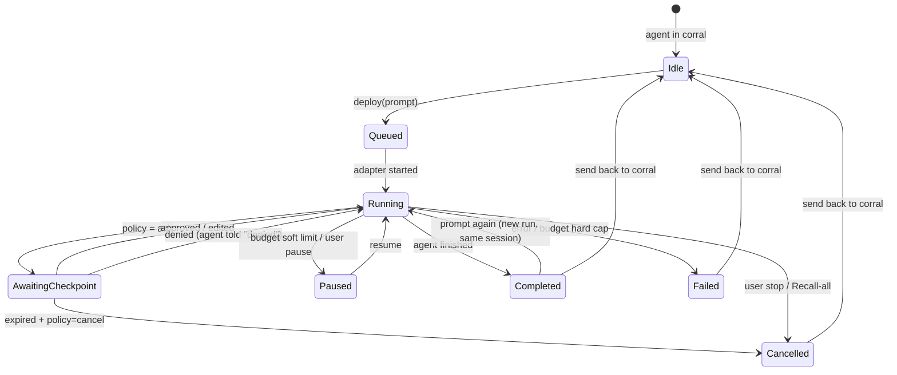

# Corral: System Design

Status: Draft v0.1 · Last updated: 2026-11-07
Read first: [00-product-brief.md](00-product-brief.md). Security details: [02-security-model.md](02-security-model.md).

---

## 1. Architecture at a glance

```
┌──────────────────────────── macOS ────────────────────────────┐
│                                                               │
│  ┌──────────── Corral.app (Tauri 2 bundle) ───────────────┐   │
│  │                                                        │   │
│  │  Webviews (React + TypeScript)                         │   │
│  │   └─ Main window: traces, agent config, policies,      │   │
│  │      spend, settings                                   │   │
│  │                                                        │   │
│  │            ▲ typed IPC (types generated with ts-rs)    │   │
│  │            ▼                                           │   │
│  │  Tauri shell (thin): windows, tray, hotkeys, updater   │   │
│  │            │                                           │   │
│  │  ┌─────── corral-core (Rust, no UI deps) ─────────┐    │   │
│  │  │ Supervisor ── Run actors (1 tokio task per run)│    │   │
│  │  │   │             │                              │    │   │
│  │  │   │        Adapter trait ──┬─ native (API loop)│    │   │
│  │  │   │                        ├─ managed (Agents) │    │   │
│  │  │   │                        ├─ acp (CLI stdio)  │    │   │
│  │  │   │                        ├─ a2a (remote)v1.1 │    │   │
│  │  │   │                        └─ fake (tests)     │    │   │
│  │  │ Policy engine (pure) ◄── every action          │    │   │
│  │  │ Budget meter          Tool gateway (fs, MCP)   │    │   │
│  │  │ Event store (SQLite, append-only, hash-chained)│    │   │
│  │  │ Secrets (Keychain)    Voice (on-device STT)    │    │   │
│  │  └────────────────────────────────────────────────┘    │   │
│  │            │ C ABI via swift-rs                        │   │
│  │  CorralNative (Swift + Metal): liquid-glass corral,    │   │
│  │  hover cards, trace tree, notifications, Touch ID      │   │
│  └────────────────────────────────────────────────────────┘   │
│                       │ HTTPS (only to configured providers)  │
└───────────────────────┼───────────────────────────────────────┘
                        ▼
   xAI · OpenAI · Anthropic · Meta Model API · MCP servers · (opt-in) sync backend
```

**The rule that keeps this clean:** every decision lives in `corral-core`: lifecycle, policy, budgets, persistence. The UI and Swift layers only *display* and *collect input*. This makes the core fully testable headlessly and keeps safety logic in one audited place.

## 2. Stack decision (ADR-001)

**Tauri 2 + React/TypeScript UI + Rust core + a Swift/Metal layer (CorralNative) for the glanceable native surfaces.**

| Option | Pros | Cons | Verdict |
|---|---|---|---|
| Tauri 2 + React/TS | Matches Anton's React/TS; small binary; Rust core for process control, Keychain, SQLite; capability-based IPC permissions; proven for menu-bar apps (tray + positioner plugin) and by production apps like Handy | WebKit webview quirks; native macOS polish needs bridging | **Chosen** |
| Native SwiftUI only | Best macOS feel | Second language for most of the code; React/TS skills unused; no path to other OSes | Used for the glanceable surfaces (corral, cards) |
| Electron | Fastest prototype | Heavier, larger attack surface, Node in the main process | Rejected |

**Split by surface (amended for the liquid-glass brand, ADR-009):**
- **Swift + Metal (CorralNative)** owns everything you see at a glance: the liquid-glass corral at the bottom of the desktop (a custom Metal shader) with agent logos, the hover cards and checkpoint buttons, the trace tree, actionable notifications, Touch ID prompts for critical approvals, App Intents/Shortcuts, and later a WidgetKit widget.
- **React (webviews)** owns deep work: trace viewer, agent and policy editors, spend, settings.
- **Rust core** owns every decision. Swift and React only display state and send intents back.

Swift is linked through `swift-rs` behind a narrow C ABI carrying versioned JSON. **Spike S1** (done 2026-11-10) confirmed the bridge, notifications and Touch ID, and found the widget packaging feasible; the findings and the process-model decision are in [adr/001-stack.md](adr/001-stack.md). **Spike S5** compiles and tunes the corral shader. See [07-brand-and-corral-surface.md](07-brand-and-corral-surface.md).

## 3. Domain model

```
AgentDefinition ─┐          ┌─ Checkpoint (0..n per run)
  id, name,      │          │    action, risk, args, preview,
  adapter kind,  │   Run ───┤    status: open|approved|denied|expired
  provider/model,├─► id,    │
  persona, icon, │   agent_id, session_id, prompt, state,
  tools (MCP),   │   budget, spend, started/ended
  policy_profile,│          │
  budget         │          └─ Event (append-only, many per run)
Session ─────────┘              seq, ts, kind, payload, parent_span,
  conversation context            prev_hash, hash
  that survives runs
```

- **AgentDefinition**: what lives in the corral. Created from the UI or a `corral-agent.toml` manifest. `icon` is a reference to a logo image the user assigned, stored in Corral's own folder (see [07 §8.1](07-brand-and-corral-surface.md)).
- **Run**: one deployment on one task. "Prompt again" creates a new Run in the **same Session**, so context carries over. "Send back to corral" closes the Session.
- **Event**: the single source of truth (ADR-002). Run state, hover cards, the trace tree, traces and spend are all *projections* of the event log.
- **Checkpoint**: a pending human decision. It is itself recorded as events (`checkpoint.opened`, `checkpoint.resolved`).

### Run lifecycle



The state machine is a pure function `next(state, event) -> Result<state>` in `corral-core::lifecycle`, covered by property tests (see test plan). Illegal transitions are errors, never silent no-ops.

**Pause and resume** (`Supervisor::pause`, `resume`; TP-SUP-04..06, EV-STOP-03). Pause asks a running run to stop at its driver's next *safe point*: drivers call `EventSink::pause_point` between steps, never mid-request or mid-tool (the agent loop before each model turn and each tool call, the fake between script steps). There it logs `run.paused` and waits, logging nothing else, until Resume logs `run.resumed` and it carries on, or Stop ends it at once. Resume before the safe point means it never pauses. Only a running run can pause or resume. Pausing keeps everything: the conversation, the budget and the spend are untouched, so a paused and resumed run logs exactly what it would have otherwise. Drivers that run their own loop elsewhere (ACP, managed agents, M5) get safe points where their protocol allows; until then they ignore a pause, and Stop still works. A driver says whether it pauses (`RunDriver::pauses`, default no), and only those agents' cards offer Pause (TP-PAUSE-01..05): pressed, the card reads Pausing until the safe point, then Paused, and the drop holds its ring still with a pause badge.

## 4. Adapter layer

Every agent kind implements one trait. The supervisor doesn't know or care which provider is behind it.

```rust
#[async_trait]
pub trait AgentAdapter: Send + Sync {
    fn kind(&self) -> AdapterKind;
    fn capabilities(&self) -> Capabilities; // streaming, tool hooks, cancel, resume…

    /// Start a run. The adapter streams normalized AgentEvents back.
    /// Before executing ANY side-effecting action it MUST call `gate.check(action)`
    /// and await the decision. Adapters cannot reach tools except through `gate`.
    async fn start(
        &self,
        ctx: RunContext,          // prompt, session history, model config
        gate: PolicyGate,         // policy + checkpoint channel + budget meter
        tools: ToolGateway,       // fs sandbox, MCP client, provider-tool toggles
        out: EventSink,
    ) -> Result<RunHandle>;

    async fn cancel(&self, run: &RunHandle) -> Result<()>;
}
```

| Adapter | Who runs the agent loop | Used for | Checkpoint mechanism |
|---|---|---|---|
| `native` (**primary**) | Corral | xAI Grok (Responses API), OpenAI-compatible endpoints, Anthropic Messages, Meta Model API (Muse Spark; it accepts the OpenAI and Anthropic SDK formats) | Full: Corral executes every local tool, so it gates every call |
| `managed` | Vendor | OpenAI Agents API | Function tools return to Corral (`requires_action`) and are fully gated. Sessions default to environment `none`, so every side effect is a Corral function tool. Hosted sandboxes and the hosted browser are opt-in, with partial gating (Spike S3) |
| `acp` | The CLI agent | Claude Code, Codex CLI, Gemini CLI, Devin CLI (local Devin sessions), any ACP agent | ACP permission requests are mapped to Corral checkpoints. Corral is the ACP *client*. Gating is `Partial` unless Corral sets the agent's permission mode for the session, because a CLI agent's own settings can pre-approve tools (T22) |
| `a2a` (v1.1) | Remote agent | Agents exposing A2A v1.0 Agent Cards | A2A `input-required` task state → checkpoint |
| `custom` | Corral (compiles to `native`) | User manifests | Same as native |
| `fake` | Test script | Tests and evals | Scripted |
| `linked` | Vendor app | Consumer Muse, consumer dots | None. Not managed; open-in-app only |

**Provider-side tools** (e.g. xAI server-side web search, code execution) run on the vendor's servers, where Corral can't intercept individual calls. They are a separate permission (`provider_tools`) decided *before* the request, and the UI labels them "runs on xAI's servers".

**Claude's web search** is the first (M3 item 4, TP-PROV-01..09). `ToolAgent::new` keeps a provider-side tool only if the agent's policy *allows* `provider_tools` (`agent::allows`; Ask isn't enough, since a search can't be paused), and the default denies it. Claude is offered Anthropic's basic `web_search_20250305`: the newer versions filter results by running code at Anthropic, which is a side-effecting vendor tool. At most 5 searches a turn, and the budget's estimate for a turn includes their $0.01 each; the cost reported is tokens plus `usage.server_tool_use.web_search_requests`. Each search is logged as `tool.requested` (class `provider_tools`, the query), `policy.decided` Allow (the pre-run decision), `tool.started` and `tool.result` with the results' titles and links only. Results taint the run before that turn's calls are decided (`Gate::taint`, T28), so ways out ask again and name "web search results from Anthropic's servers". The answer lists the sources it cites (at most ten, each once), as Anthropic requires when results are shown to a user. The assistant's content blocks go back exactly as they came, encrypted results and citations included, and a turn Anthropic pauses (`pause_turn`) is sent back and resumed. Grok's web search waits for a recording: xAI doesn't document its search stream.

**The switch** (TP-PROV-10..14) is in the main window, under **Provider tools**: one switch per tool the catalog offers (`catalog::provider_tools`: Claude's web search so far), off until turned on, with where it runs, what it costs and that what it finds is untrusted. The choice is saved in the app data folder as `provider-tools.json`; a file that can't be read leaves every tool off and the window says why, and a choice that can't be saved doesn't take effect. Claude is built twice at launch, with search (the default profile plus one rule allowing `provider_tools`) and without, over the same tools and desk; `catalog::Switched` sends each run to one or the other by the switch as it is when the run starts, so a change needs no restart and never reaches a run already going.

**Gating rules from Spike S3** ([findings](spikes/S3-provider-approval-hooks.md)): only OpenAI's hosted MCP offers per-call approval for vendor-executed tools; xAI, Anthropic and Meta offer only up-front allowlists. So:
- **Corral connects MCP servers itself.** MCP always goes through Corral's own MCP client in the `ToolGateway`, never through a vendor-hosted MCP connector.
- **Tool results are capped** before they reach the model: 16 KB of text by default, per profile. The full output stays in the trace and the model sees a truncation marker (T30).
- **Read-only vendor tools** (web search) are a deploy-time `provider_tools` permission.
- **Side-effecting vendor tools** (code execution with network, hosted shells and sandboxes, the hosted browser) are off by default and high-risk to enable.
- **Adapters report a `gating` level** (`Full` / `Partial` / `PreflightOnly`) in `Capabilities`. A run below the agent profile's minimum (default `Full`) won't start.
- **Corral never enables vendor auto-approval** such as the Agents API's `auto_review`.
- **Launching a program is itself gated.** Starting an MCP server or an ACP agent command asks once per (path, SHA-256) as an `exec.shell`-class checkpoint; a changed binary asks again (T23). ACP agents run under a small reaper that kills their process group when Corral's pipe closes, so a crash can't orphan them (T26).

### Provider clients
`corral-adapters::providers` holds one thin client per wire format: `openai_responses`, `openai_chat` (legacy fallback), `anthropic_messages`. xAI and the Meta Model API reuse the OpenAI-compatible clients with a different base URL and key. Each client normalizes streaming deltas, tool calls and usage into `AgentEvent`s. Model IDs are config, never hard-coded. The clients share one driver (`stream.rs`: key at request time, budget admission, retries on 429, 503 and 529, idle timeout, Stop); each brings only its endpoint, headers, body and stream decoder. `anthropic_messages` sends the key in `x-api-key` with `anthropic-version: 2023-06-01`, and computes cost from tokens because Anthropic reports none (SK-7).

The first client, `corral_adapters::responses` (SK-4), speaks the OpenAI Responses format to xAI. It sends `store: false`, so conversations stay off xAI's servers. It reports the provider's billed cost (`usage.cost_in_usd_ticks`, 10^-10 USD, rounded up to micro-USD). It retries 429 and 503 up to three attempts in all, honoring `Retry-After`. It never repeats a provider's 401 message, which echoes part of the key. HTTPS goes through `reqwest` with `native-tls`, which is Security.framework on macOS: the system trust store and no bundled crypto. Tests replay cassettes (`tests/cassettes/xai/`). `cargo run -p corral-adapters --example record_xai` records real exchanges on a Mac, so the same tests also run against what xAI actually sends.

For an agent with tools (M3), `ResponsesConfig::turn_body` offers them as function tools under their wire names, one call at a time (`parallel_tool_calls: false`, so checkpoints come one by one), and carries the whole `Conversation` as input items: the prompt, the model's replies, each call exactly as the model made it, and each output. Nothing is stored at xAI, so every turn resends it, and the budget's estimate for a turn counts all of it plus the tools' descriptions. `ResponseDecoder::offering_tools` reads each finished `function_call` (capped at 1 MB of arguments) and ends the response without `run.completed`, so the agent loop can run the calls and ask again (TP-TOOL-04..06). Tools that run on xAI's servers are still refused.

**The agent loop** (`corral_adapters::agent::ToolAgent`, TP-TOOL-07..12, 18) runs a task as turns, over any API that implements `ToolProtocol`: Grok over the Responses API (`ResponsesAgent`) and Claude over the Messages API (`MessagesAgent`). Claude's request offers the tools as `name`, `description` and `input_schema`, one call at a time (`disable_parallel_tool_use`); each turn goes back as an assistant message with its text and `tool_use` blocks, then a user message with a `tool_result` for each; the decoder assembles each `tool_use` block from its streamed JSON pieces, and tools that run at Anthropic stay refused (TP-TOOL-16..17). Each turn is one request with the whole conversation and the agent's tools, admitted by the budget meter. Each call the model makes is mapped back from its wire name (a name it wasn't offered stays as it is and is `unknown`, so it's denied without asking) and goes through the agent's `ToolRunner`, exactly like the fake agent's: the policy decides, an Ask waits at a checkpoint on the card, and only an allowed call runs. The output, or why the call didn't run (with the user's note on a Deny), goes into the next turn. Arguments that aren't a JSON object run nothing and log nothing; the model is told. The run completes when the model answers without a call. Stop drops a request in flight, and the runner takes a waiting checkpoint off the desk; nothing is sent after Stop. When the next turn would pass the soft limit, the runner asks on the card first. A run gets at most 20 turns (`DEFAULT_MAX_TURNS`), then fails with a plain message rather than spend on.

### Custom agent manifest

```toml
# ~/Library/Application Support/Corral/agents/scout.corral-agent.toml
name        = "Scout"
adapter     = "native"
provider    = "xai"                 # key resolved from Keychain item "corral.xai"
model       = "grok-4.5"            # user-editable; validated against provider /models
persona     = "You research topics and return cited summaries."
icon        = "scout.png"           # optional; relative to the manifest, copied in at import
provider_tools = ["web_search"]     # vendor-side; needs policy allow

[[mcp_servers]]
name    = "notes"
command = "/usr/local/bin/notes-mcp"
secrets = { NOTES_TOKEN = "keychain:notes-mcp" }   # names a Keychain item; never the value (T29)

[policy]
profile = "researcher"              # see policy profiles below

[budget]
per_run_usd   = 0.50
monthly_usd   = 20.00
```

The manifest is parsed with a strict schema (unknown keys are an error) and fuzzed (see test plan). Importing a manifest from someone else always shows a permissions summary before it's added.

## 5. Policy engine and checkpoints (ADR-003)

Pure, deterministic, deny-by-default. Input: `(agent policy profile, action, run context)`. Output: `Allow | Ask{risk, reason} | Deny{reason}`.

The run context includes `tainted`, which the core sets the first time a run takes in untrusted content (network reads, provider web search, responses from MCP servers the profile doesn't mark trusted, files read outside the sandbox roots). On a tainted run, allow-for-run grants on the classes that can send data out (`net.write`, `comms.send`, `net.read.unlisted`, `a2a`) don't apply: each action asks again. This breaks the "lethal trifecta" of private data, untrusted content and a way out within one run (T28).

**Action classes** (every adapter maps its actions to exactly one of these):

| Class | Examples | Default |
|---|---|---|
| `read.local` | read a file inside sandbox roots | allow |
| `read.local.outside` | read outside sandbox roots | ask |
| `write.local` | create or modify a file inside sandbox roots | ask (can be widened to allow) |
| `delete.local` | delete any file | ask (high) |
| `exec.shell` | run a command (ACP agents) | ask (high) |
| `net.read` | HTTP GET to an allowlisted domain | allow |
| `net.read.unlisted` | HTTP GET to an unlisted domain | ask |
| `net.write` | POST/PUT/DELETE, form submits, webhooks | ask (high) |
| `comms.send` | email, message, post | ask (high) |
| `money.spend` | purchases, payments | ask (critical, Touch ID) |
| `provider_tools` | vendor-side tools | decided at deploy |
| `budget.threshold` | run or month spend crosses soft limit | ask |
| `unknown` | anything not mapped | **deny** |

These defaults match the planning decisions. Outbound actions, file and shell actions, and budget thresholds all stop at a checkpoint, and every agent gets its own editable profile.

**Profile example:**

```toml
[profiles.researcher]
sandbox_roots   = ["~/Corral/Scout"]
net_allow       = ["*.wikipedia.org", "arxiv.org"]
rules = [
  { class = "write.local",  decision = "allow" },      # widened for this agent
  { class = "net.write",    decision = "deny"  },
  { class = "comms.send",   decision = "deny"  },
]
checkpoint_timeout = "30m"
on_timeout         = "deny"   # deny | cancel_run
```

**Agents' names** (M4 item 6, TP-ANM-01..04). An agent's name is also its folder, `~/Corral/<name>`, its file tools' sandbox (decided 2026-11-24: the folder follows the name; a rename starts a new folder and leaves the old one as it was). So a name is one plain path component (`corral_core::agent_name`): ASCII letters and digits, spaces, `-` and `_`, starting and ending with a letter or digit, at most 32 characters, and names differing only in case are the same name, as on the Mac's file system. A rename is saved in the agent's settings file beside its model and cap. The app's one lookup, `AgentNames`, names the agent on its card (with a monogram from the name), in the main window's sections, and in its folder. It fails closed: a saved name that can't be used, or that two agents share, is dropped, and each keeps its catalog name and its own folder. No agent can be given another agent's catalog name, so every default folder stays its own agent's.

**Where each agent's profile lives** (M4 item 6, TP-PED-01..06): `<app data>/policies/<agent>.toml`, the profile the policy editor saves, read at launch. No file means the defaults. A file that can't be used (unreadable, not a valid profile, a rule above a ceiling, a bad domain) is an error, never the defaults, and that agent gets no tools until it's fixed (fail closed). The editor shows each class's *effective* decision and where it comes from (the default, the agent's own rule, or a ceiling that capped it; `unknown` is fixed), and an edit above a ceiling is refused, not capped, so what's saved is what applies. `provider_tools` is the agent editor's switch, not a policy-editor rule. Allowed domains are plain lowercase hostnames or one leading `*.` over at least two labels, punycode for international names (T20).

**The policy editor** (M4 item 6, TP-PED-07..09) is the main window's Policies section. The core sends each catalog agent's view (`agent_policies`): every class in display order with its decision, where it comes from, the agent's own rule, its ceiling and whether it's editable, plus the domains, the wait and what happens after it, and the loop limit. A broken file is shown with the defaults and a note that the agent has no tools; saving replaces it. The window offers no rule above a class's ceiling and sends the whole form (`save_agent_policy`); the core checks it with `Policy::edited` and keeps it, or says why not and changes nothing. A save bumps that agent's settings version, and its driver (`corral_adapters::catalog::Rebuilt`) is built again when its next run starts, so there's no restart; a run already going keeps the driver it started on.

**Checkpoint resolution options:** Approve once · Deny (with optional note sent to the agent) · Edit arguments then approve · Allow for the rest of this run. For normal-risk classes, allow-for-run covers the class. For high and critical classes it covers the class *and the destination* (same recipient, domain or path root), so one approval can't sweep through a later injected action (T21). "Allow forever" is *only* available in the policy editor, never one click away on a checkpoint. That keeps approval drift deliberate.

**Approve once per exact call** (TP-POL-08, decided 2026-11-18, T4): approving a normal-risk call once also covers the exact same call (same tool, same arguments in any key order) for the rest of the run, so re-reading or re-writing the same file doesn't ask again. A different argument asks, and so do high and critical calls, spend limits, edited calls (an edit is for that call only), any way out once the run is tainted, and every call from the loop detector's limit on. A denied or refused call records nothing, and nothing carries over to the next run.

**Where it lives (M2, `corral-policy`):** `Policy::decide(&Action, &RunGrants) -> Decision`. A `Profile` is read from TOML strictly (unknown keys, unknown classes, duplicate rules and any rule that opens `unknown` are errors) and is capped by global `Ceilings` (money, deleting and running commands always ask at least). Provider-side tools are denied unless the profile allows them. `RunGrants` holds a run's allow-for-run grants and its taint and is never saved. Every decision carries a plain-words reason for the checkpoint. Mutation testing catches every viable mutant (37 of 37).

**The gate and the gateway (M2 item 3, T2).** Each run gets a `Gate` (its policy plus its grants and taint). `Gate::check(ToolCall)` returns `Allow(AllowToken)`, `Ask(PendingApproval)` or `Deny`. A `PendingApproval` turns into a token only through `approve(how, Once | ForRun)` with a gesture its risk allows; a refused gesture hands the checkpoint back still open. An `AllowToken` can't be built, cloned or reused outside `corral-policy` (compile-fail doc tests). `corral_tools::ToolGateway::run(token)` runs exactly the call the token carries, only if the registered tool's class matches the class the policy decided on, caps the output the model sees at 16 KB on a character boundary (keeping the full output for the trace), and taints the run when the tool read untrusted content. A tool that can be offered to a model has a `ToolSpec` (a description and a JSON schema for its arguments); `ToolGateway::offered` lists those tools under wire names (`fs.read` goes out as `fs_read`, because function names allow only letters, digits, `_` and `-`), and `from_wire` maps a called name back, so a name the model makes up matches no tool and is `unknown` (TP-TOOL-01..03).

**Checkpoints in the core (M2 item 4).** `corral_tools::ToolRunner` takes one run's tool calls through its gate: `tool.requested` (the class comes from the gateway's registry, so an unregistered tool is `unknown` and denied) → `policy.decided` → for an Ask, `checkpoint.opened` with a title written by the core and the exact detail (tool, destination, arguments verbatim, capped at 2,000 characters) → `checkpoint.resolved` → `tool.started` → `tool.result`. A denied call never reaches `tool.started`; the agent is told why (with the user's note, capped at 1,000 characters) and carries on. The call waits at the shared `CheckpointDesk`, which takes one accepted answer per checkpoint: a stale or replayed ID finds nothing, and a gesture too weak for the risk is refused with the checkpoint still open. Nobody answering within the profile's `checkpoint_timeout` resolves it as `expired` and denies the call, or cancels the run under `on_timeout = "cancel_run"`. Stop takes the checkpoint off the desk, and Stop wins over an answer that arrives at the same moment. A tool's destination is read from its arguments by the tool itself (`Tool::destination`), never from the model. **Edit, then approve** (`Answer::Edit`, TP-POL-06): the user changes a waiting call's arguments and approves the changed call. The tool and its class can't change, so the risk and the gesture it needs stay the same; the tool reads the destination again from the edited arguments; and it's an approval for that one call, never a grant for the run. Only the edited call runs. `tool.requested` keeps what the agent asked for and `checkpoint.resolved` records what ran instead (`edited`, with the arguments), so the trace has both. Edited arguments are capped at 16 KB of JSON, and a spend-limit checkpoint can't be edited, because its numbers are the core's. A refused edit leaves the checkpoint open with the original call. The file tools (`fs.read`, `fs.write`, `fs.delete`, M2 item 6) work only inside the agent's `sandbox_roots`, through `corral_tools::fs::Sandbox`, which opens every path beneath the root's directory handle (security model T8).

**The loop detector (M2 item 7, T9).** Each run's gate counts identical calls: the same tool with the same arguments, with object keys sorted so reordering them doesn't dodge the count. From the profile's `loop_limit`-th one on (5 by default, 2 to 1,000), each identical call asks before it runs, even when the policy allows it outright or the user allowed the class for the run; the card says "Same call 5 times in this run." A denied call stays denied. Approve runs that one call; Deny tells the agent, which carries on. A new run starts counting from zero.

**Checkpoints in the hover card.** While a checkpoint waits, the agent's run card (`corral_core::run_card`) carries it, drawn only from `checkpoint.opened` (class, risk, title, detail; cleaned and capped again at 120 and 2,000 characters), with Approve and Deny; the oldest waiting one shows first. It rides on the roster (`roster-checkpoint-v1.json`). Approve and Deny come back as the intents `approveCheckpoint` and `denyCheckpoint` with the checkpoint's ID. The shell answers only the checkpoint that agent's card shows now (`RunCards::shows_checkpoint`) and hands it to the desk, which takes it once and lets the policy check the gesture. A card only reports a click; Touch ID and voice never come from a card, so a critical checkpoint can't be approved there yet. The card's field takes a note for Deny. In the app, Grok's and Claude's tool calls and spend checkpoints wait on this desk (M3, `crate::agent_tools`): each gets the file tools over its own folder, `~/Corral/Grok` and `~/Corral/Claude` (made if missing; without it the agent answers with no tools), under the default policy, so reading is allowed, writing asks, and deleting asks at high risk. Neither can reach the other's folder. Tool-call and checkpoint IDs are 128 random bits from the operating system, because the ID is what makes an answer single use (TP-TOOL-13..14, 19). Each run has a $0.10 soft limit under its $0.25 cap. **Edit on the card** (TP-CHK-13..14): the run card's `edit` lists the waiting call's arguments from its `tool.requested`, one field per top-level argument, labeled in words (`file_path` reads "File path"). Text and numbers are editable; booleans, null, nested values, and text or keys with hidden or control characters show read-only, cleaned and cut at 200 characters. Arguments that aren't an object, are over 8 KB or 20 keys, or have nothing editable get no fields, and neither does a spend limit, which has no tool request. The card sends back only the fields it changed, and `RunCards::edited_args` merges them into the agent's arguments: only editable keys, numbers must parse, edited text must be plain. Read-only and nested values never cross back. The fields ride on the roster as the checkpoint's `fields`, and the card's edit sheet (docs/07 §8.2) sends `editCheckpoint` with only the changed fields (TP-CHK-15..16). **Approve with Touch ID** (TP-CHK-17..18): a critical checkpoint's Approve, under high risk's rules, sends `approveWithTouchId`. The shell's `TouchIdDesk` checks that the card shows that critical checkpoint now and mints a single-use request; Swift's prompt asks macOS for Touch ID, or for the login password when Touch ID can't be used (decided 2026-11-18). Only an `ok` result for the request that's up approves, with `Approval::TouchId`, once; the desk and the policy check it like any answer. Cancelled, failed or unavailable leaves the checkpoint waiting. One prompt is up at a time.

**Risk tiers → required gesture:**
- normal: click or keyboard
- high: click; voice cannot approve
- critical (`money.spend`, `delete.local` outside sandbox): Touch ID via CorralNative, or the Mac's login password where Touch ID can't be used

## 6. Event store and traces (ADR-002)

- SQLite (WAL mode) at `~/Library/Application Support/Corral/corral.db`. Large payloads (tool outputs over 64 KB) go to content-addressed blobs next to it.
- Append-only `events` table: `(run_id, seq, ts, kind, span_id, parent_span_id, payload_json, prev_hash, hash)`. The hash chain makes after-the-fact edits detectable. To catch a *whole-log* rewrite, each run's final head hash is MACed with a key held only in the Keychain and verified on open (T24).
- Projections (`runs_view`, `spend_view`, `checkpoints_view`, `usage_rank`, `plan_view`) are rebuilt from events and can be dropped and regenerated at any time. A test proves the rebuild gives identical results.
- **Trace export** follows OpenTelemetry GenAI semantic conventions (`invoke_agent`, `chat`, `execute_tool` spans; `gen_ai.*` attributes). Those conventions are still marked *Development*, and in June 2026 they moved to a dedicated repository, so we **pin a version** in `corral-core::otel` and run a mapping test per version bump. Export is opt-in: OTLP to a user-specified endpoint (Langfuse, Phoenix, Jaeger) or a JSON file.
- Prompt and response content is stored locally only. Export redacts content unless the user explicitly enables it.

### Event kinds (v1)
`run.queued · run.started · plan.updated · model.request · model.delta · model.response · tool.requested · policy.decided · checkpoint.opened · checkpoint.resolved · tool.started · tool.result · usage.reported · budget.warned · run.paused · run.resumed · run.completed · run.failed · run.cancelled · session.closed`

## 7. Budgets

`BudgetMeter` sits in front of every model request. It estimates cost before the request (tokens × price table, which is config) and blocks if the request would cross a **hard cap**. Because output and reasoning tokens aren't known up front, every request also sets its max output tokens from the remaining budget, and per-call vendor tool fees are priced before the call (T25). When the provider reports usage, it reconciles to the real numbers. A **soft limit** raises a `budget.threshold` checkpoint. Caps exist per run, per agent per month, and globally. The price table is versioned config with a "last verified" date shown in the UI.

How the hard cap is enforced (SK-5, `corral-core/src/budget`): each run's `EventSink` holds the run's budget, and `model.request` can be logged only through `EventSink::request_model`, which asks the meter first. A request's worst case is its input (bounded before the call at one token per byte of the prompt, plus 256 tokens of overhead), its vendor tool fees, and its output limit. The meter refuses a request when even a 16-token answer wouldn't fit; otherwise the request carries the most output tokens the remaining budget pays for, up to the adapter's ceiling. Admitted requests that haven't reported usage count at their worst case. `usage.reported` replaces the reservation with the billed cost, or with tokens × price if the provider reports less, so spend is never under-counted. **Long-prompt prices** (TP-BUD-08): some models charge more for every token of a request whose prompt is long enough (Grok 4.7 doubles from 200,000 prompt tokens). The worst case and the output limit use the rate the input bound pays, which is never below the rate the real prompt pays, and a bill is priced at the rate of the prompt the provider reports. A refusal fails the run with `budget_hard_cap` and nothing is sent. Until agent manifests land, the per-run cap is one setting for every run ($1 by default). **Each agent's own monthly cap** (TP-AED-01): the agent editor sets one from $0 up to the all-agents cap, which still holds for everyone; an agent without one has the default ($25). `SpendLedger::set_agent_cap` refuses a cap above the all-agents cap, and a cap takes effect at the agent's next request. **Each agent's model and cap, saved** (TP-AED-02..04): `<app data>/agents/<agent>.toml`. A model can be chosen only from the catalog's table (`catalog::models`), each at its list price checked on the provider's pricing page, so a model is never metered at another's rate; the nightly live check wants every one still listed. At launch each agent gets its saved cap; a file that can't be used, or a cap above the all-agents cap, leaves that agent at $0 and says why (fail closed).

How the soft limit works (M2 item 5, TP-BUD-02): a run can have a soft limit below its cap (`Supervisor::set_soft_limit`; none by default). Until the user approves going past it, requests are admitted under the soft limit instead of the cap, so a request's worst case is held under it. At it, `request_model` refuses the next request without failing the run and logs `budget.warned` once. The driver then asks: `ToolRunner::past_soft_limit` puts a `budget.threshold` decision to the policy (ask by default; a profile can allow or deny it) and, when asked, opens a checkpoint on the agent's card ("This run has used $0.60; its soft limit is $0.50. Approve to let it go on, up to its $1.00 cap."). Approve lifts the limit to the cap for the rest of the run (`EventSink::raise_to_cap`). Deny or Stop cancels the run, and no answer by the checkpoint timeout cancels it whatever `on_timeout` says, because an unanswered soft limit never means spend more. Grok's agent loop asks before the turn that would pass it (TP-TOOL-12); an agent that can't ask (the text-only drivers) stops at the soft limit with `budget_hard_cap`, sending nothing.

How the monthly caps work (M2 item 5, TP-BUD-03..04, TP-BUD-06..07): one `SpendLedger` is shared by every run. `EventSink::request_model` admits a request under its run's limits, its agent's monthly cap and the monthly cap for all agents together in one step under the ledger's lock, so runs racing each other can't add up past a cap; the tightest of the three sets the request's output limit. Like a run's budget, the ledger counts what was billed this month plus the worst case of every request in flight, and `usage.reported` replaces the hold with the charged cost. The defaults are $25 a month per agent and $100 a month for all agents. Months are the user's calendar months (the Mac's time zone): spend rolls over at local midnight on the first, a request in flight at midnight stays held, and a clock that goes back never reopens an old month. At launch the shell seeds the ledger from the event store (`Store::spend_since`, one query) and refuses to start if it can't read it, because counting from nothing could spend past a cap. A refusal fails the run with `budget_hard_cap`: "This agent would go over its $25.00 monthly spend cap ($24.99 used this month). Raise the cap or wait until next month." The caps become editable in Settings later.

## 8. Concurrency and the supervisor

- One tokio task (actor) per run, owning that run's state. Its mailbox receives `Cancel`, `Pause`, `CheckpointResolved`, `AdapterEvent`.
- The supervisor owns the actor registry and enforces global limits: max concurrent runs (default 8) and per-provider rate limits.
- **Recall-all** (global hotkey + menu item) broadcasts `Cancel` to every actor. Adapters must stop within 2 s or are force-dropped: ACP child processes are killed, HTTP streams are aborted. Covered by an eval. Today it's **Stop all agents** in the corral's right-click menu (`CorralControls::stop_all`); the hotkey comes with M4.
- **FakeAdapter** (`corral_adapters::fake`): a scripted agent (say, wait, usage, a tool request, a failure, a stubborn step that ignores Stop) run through the real supervisor, so the core's lifecycle, budget and Stop paths are tested without a model. EV-STOP-01 runs on it today (8 fake runs, Recall-all within 2 s); with a `ToolSetup` its tool steps go through the real gate, desk and gateway. The eval runner builds fake scripts from scenario files and runs them through the real policy, desk and gateway (docs/05 §4).
- Crash safety: on launch, any run in `Running` without a terminal event is marked `Failed{reason: "app_restarted"}`. Runs are not auto-resumed in v1.
- **Process model (decided in Spike S1):** the Swift UI is linked in-process, so a UI crash would take the supervisor down. S1 decides between keeping one process (with hardened, bounded Swift input) and running the core as a separate helper process the UI talks to. Closing the main window never quits Corral; only Quit does.

## 9. UI surfaces

**Desktop form:** a liquid-glass corral at the bottom center of the desktop, a trace tree and hover cards above it, and a main window for deep work. Full spec: [07-brand-and-corral-surface.md](07-brand-and-corral-surface.md).

- **The corral (Swift + Metal):** each shown agent is a glass drop. Drops are joined by liquid bridges into a shape that encodes the count: circle, dumbbell, triangle, square, then polygons up to an octagon (8 is the maximum; with more agents the user chooses which show). The most-used agent sits top-left and the rest follow clockwise, re-ordered as usage changes. Each drop shows the agent's logo: for a provider agent, its provider's icon, fetched when the key is connected (ADR-015). **Working agents stay in the shape** (ADR-014); status shows as a ring and badge around the logo.
- **Hover cards (SwiftUI, paper material):** hovering or focusing a drop opens a card with the agent, its current task, segmented plan progress, elapsed and spend, the pending checkpoint's exact detail, and the buttons for its state (Approve / Deny / Edit…, Pause / Stop, Send back / New task, Trace ›).
- **Trace tree (SwiftUI, translucent cards):** one column per running task above the corral (max 3): prompt pill → task card → stack of subtask cards, wired into the agent's drop. Subtasks come from the `plan_view` projection: `plan.updated` events from the adapter (ACP plan updates, a native plan tool), or top-level trace spans when the agent publishes no plan.
- **Prompt bar** (spec: [07 §6.1](07-brand-and-corral-surface.md)): appears instantly above the corral, like a command palette. A prompt goes to the agents named with `@` at its start (shown or hidden; `corral_core::mention`), else to the ⌘-clicked drops; with neither, only an explicit Deploy all sends, to the shown agents. Busy agents are skipped and named. A mic button (push-to-talk) arrives with voice.
- **Menu-bar icon:** a fallback entry point (show corral, settings, quit).
- **Main window (deep work):** trace viewer (span tree plus waterfall, filter by kind, copy as JSON), agent editor, policy editor (shows the effective decision for each action class), spend dashboard, settings.
  - The trace viewer's spans are a projection of the run's events (`corral_core::trace_view`), named as OpenTelemetry's GenAI conventions name them: the run ("invoke_agent <agent>"), a span per model call ("chat <model>") and per tool call ("execute_tool <tool>") under it, a checkpoint under its tool call, and zero-length marks for budget warnings, pauses and plan updates. Model text, arguments and results in them are agent text, cleaned and capped. Its run list is `Store::recent_runs`: the newest 200 runs in one query. The main window shows the newest 100 (`traces.rs`: agent names, prompts cleaned and capped at 200 characters); opening one reads its events in one query and shows the tree, each span with its status, duration and a bar on the run's timeline, filtered by kind, with the picked span's attributes. "Copy as JSON" copies the run's events as the log holds them. The commands read the store the corral opened; until then they say it isn't open.
- **Notifications:** checkpoints raise an actionable notification (Approve / Deny / Open). High and critical risks open that agent's hover card above the corral instead of offering inline approve.
- **Global hotkeys (configurable):** summon corral + prompt bar, push-to-talk, Recall-all.
- Native state: Swift receives roster and run snapshots plus deltas from the core over the C ABI. For the corral, the core sends the shown agents in the corral (≤ 8), already sorted by `usage_rank`; Swift only maps rank → slot. A shared snapshot fixture format drives both SwiftUI previews and Storybook.
- **Agents from keys (TP-VIEW-06):** until manifests (M5), the corral holds one agent per connected provider (`corral_adapters::catalog`): Grok for xAI, Claude for Anthropic, GPT for OpenAI, Muse Spark for the Meta Model API. Connecting a key adds its drop; removing it takes the drop away. `AgentRouter` sends each run to its agent's provider client; an agent whose client hasn't landed yet ends its run with a plain message.
- **Linked apps (TP-LINK-01..05, ADR-005):** consumer Muse and your dot can be shown as linked drops from the corral's right-click menu (`corral_adapters::linked`). They follow the agents Corral runs, show the app's picture, and their card has only Open, which goes to a fixed URL on the app's own site. They never reach `CorralControls`, so they can't be given tasks. The choice is saved in the app data folder as `linked-apps.json`.
- **Run cards and controls (core, SK-6):** `corral_core::run_card` projects each drop's card from the log: status, elapsed time from `run.started` (stopping at the end), spend from `usage.reported`, the answer and any error as agent text (cleaned and capped by `corral_core::agent_text`, T20), and the buttons for its state (07 §8.2). The cards ride on the roster snapshot (`roster-cards-v1.json`), republished on every change and once a second while a clock is moving. `corral_core::controls` decides what a click does: deploy from a drop (a new session, or a follow-up in the open one), Stop, Send back (logs `session.closed`) and Retry (the failed prompt, same session). The shell only routes intents to it.
- **Usage ranking (core):** `usage_rank` scores each agent by deploys in the last 90 days with a 14-day half-life. Tie-breaks are most recent deploy, then creation order. New orders are published only when the corral reports idle, with 10% hysteresis between neighbors. Details: [07 §3.1](07-brand-and-corral-surface.md). The logic is `corral_core::usage_rank`; the app keeps the order, "Keep order fixed", the agents and the shown set in `corral-order.json` (`corral_order.rs`), seeds the score from the log's last 90 days of `run.queued` at launch, and sends Swift only the shown agents, most used first.
- Frontend state: TanStack Query for command results plus a per-run event subscription. Zustand for UI-only state. Every component has a story (Storybook) with fixture event streams.
- Accessibility: full keyboard path for deploy, approve and deny; VoiceOver labels on every status; never color-only status.

## 10. Voice

Push-to-talk → on-device transcription → text in the prompt bar (editable before send by default; "send on release" is an opt-in setting). Built on the same approach and crates as Handy (Whisper-family and Parakeet models, VAD), so audio never leaves the Mac. Voice can deploy, prompt, pause and stop. **It cannot approve high- or critical-risk checkpoints**, because misrecognition must never authorize an outbound action.

## 11. Secrets

API keys go in the macOS Keychain (one item per provider, access-controlled to the signed app; `corral-secrets`, items `corral.<provider>`, account `api-key`). They are never written to SQLite, logs, traces, manifests or sync. They're fetched just in time per request and zeroized after use. Settings show only the last 4 characters: the webview sends a key in through a command it must be granted, and gets back only a status (TP-SETUP-01). Keys come in through one field for any provider: the core suggests the provider from the key's prefix and the user can change it (TP-SETUP-05). Then the core checks the key by asking that provider for its model list, which spends no tokens (TP-SETUP-02). A refused key, or one that couldn't be checked because the provider was unreachable, is never stored; a provider with no known check yet (the Meta Model API) is stored and marked unchecked. ACP CLI agents receive keys through env vars only if the user maps them, and the mapping is shown in the agent's permission summary.

## 12. Optional sync (v1.1, ADR-006)

Local-first, with sync off by default. Because history is an append-only event log, sync is replication of encrypted event batches: per-device keys, a shared corral key wrapped per device, and ciphertext only on the server. The first backend is the user's own iCloud (CloudKit private database). An S3-compatible backend is a follow-up. **What never syncs:** API keys, Keychain items, raw blobs above a size limit unless opted in. Conflicts can't happen on events (append-only, `(device_id, seq)` keys). Agent definitions and policies use last-writer-wins with a visible conflict note.

## 13. Repository layout

```
corral/
├─ apps/desktop/
│  ├─ src/                 # React + TS (panel, main window, components, stories)
│  └─ src-tauri/           # thin Tauri shell: windows, tray, hotkeys, IPC wiring
├─ crates/
│  ├─ corral-core/         # domain types, lifecycle, supervisor, budget, otel mapping
│  ├─ corral-policy/       # pure policy engine + profiles
│  ├─ corral-store/        # SQLite event store + projections
│  ├─ corral-secrets/      # provider keys in the Keychain
│  ├─ corral-adapters/     # trait + native/managed/acp/a2a/fake + provider clients
│  ├─ corral-tools/        # tool gateway: fs sandbox, MCP client
│  ├─ corral-voice/        # STT (Handy-derived)
│  └─ corral-evals/        # eval runner + graders
├─ native/CorralNative/    # Swift + Metal: liquid-glass corral, hover cards, trace tree, Touch ID
├─ evals/                  # scenarios, injection corpus, golden traces
├─ docs/                   # these docs + ADRs
└─ .github/                # CI, templates, CODEOWNERS
```

## 14. Decision log

| ADR | Decision | Status |
|---|---|---|
| 001 | Tauri 2 + React/TS + Rust core + Swift native package; C ABI with versioned JSON; core in-process for v1 | **Accepted** 2026-11-10 ([adr/001-stack.md](adr/001-stack.md)) |
| 002 | Event-sourced, hash-chained run log; all views are projections | Proposed |
| 003 | Policy in Rust core, pure and deny-by-default; adapters can't bypass the gate | Proposed |
| 004 | Native API runner is the primary adapter | Proposed |
| 005 | No unofficial wrappers for consumer agents (Muse, dots); "linked app" until official APIs exist | **Accepted** 2026-11-12 (owner decision): linked drops for consumer Muse and your dot, open-in-app only (07 §8.2.1) |
| 006 | Local-first; opt-in E2E-encrypted event replication for sync | Proposed |
| 007 | Trace export uses a pinned version of the OTel GenAI conventions | Proposed |
| 008 | Voice cannot approve high/critical checkpoints | Proposed |
| 009 | Glanceable surfaces (corral, cards, checkpoints) are native SwiftUI + a custom Metal liquid-glass shader; deep-work surfaces are React | Proposed (confirm after Spike S5) |
| 010 | Glass material is system Liquid Glass with a Metal pass for shape and highlights (plan A/B per Spike S5; wallpaper crop only as fallback); never Screen Recording | Proposed |
| 011 | Minimum macOS 26, so system Liquid Glass is always available | **Accepted** 2026-11-07 |
| 012 | Corral shows at most 8 drops (octagon); with more agents the user chooses the shown set. Drops are ordered by usage: rank 1 top-left, then clockwise, re-ranked from a decayed usage score in the core | **Accepted** 2026-11-07 |
| 013 | Corral owns tool execution: MCP through Corral's own client, vendor-executed side-effecting tools off by default, adapters report a gating level, never vendor auto-approval (Spike S3) | Proposed |
| 014 | Working agents stay in the corral. Hover cards (paper) carry progress and checkpoint buttons; a trace tree of translucent stacked cards shows running tasks. Replaces pinch-off activity cards. Agent logos are user-assigned; no third-party marks ship in the repo | **Accepted** 2026-11-07 |
| 015 | Provider logos are fetched at runtime: when a provider's key is connected, Corral downloads that provider's own icon from one fixed HTTPS URL on its own site and shows it in the drop. Still no third-party marks in the repo. Fetched logos are untrusted input (T19): redirects only to the provider's HTTPS hosts, PNG or ICO by header, ≤ 1 MB and ≤ 1024 px, saved under fixed names in Corral's folder, decoded by ImageIO as a ≤ 256 px thumbnail. A provider without a working source (OpenAI today) keeps its monogram. Amends ADR-014's user-assigned logos; user-assigned logos (07 §8.1) still come later and take precedence | **Accepted** 2026-11-12 ([adr/015-provider-logos.md](adr/015-provider-logos.md)) |

Each ADR becomes `docs/adr/NNN-title.md` when accepted.

## 15. References (checked 2026-11-07)

- xAI API is OpenAI-compatible with a Responses API and server-side tools: https://ai-sdk.dev/v7/providers/ai-sdk-providers/xai · https://docs.apiyi.com/en/api-capabilities/grok/overview
- Meta Muse is a consumer agent on a Meta-hosted VM: https://www.bitdoze.com/md/muse-ai-meta-agent.md · Meta Model API / Muse Spark / Muse Code: https://developer.meta.com/ai/ · OpenAI- and Anthropic-SDK compatibility: https://medium.com/@isaakmwangi2018/meta-muse-spark-1-1-tutorial-benchmarks-pricing-5dc7aa1f08f8
- OpenAI dots have no dots API; developers use the Agents API: https://www.rewarx.com/blogs/what-is-openai-dots-complete-overview-and-architecture-explained · Agents API public beta: https://techjacksolutions.com/?p=91547
- Provider approval hooks (Spike S3): see [spikes/S3-provider-approval-hooks.md](spikes/S3-provider-approval-hooks.md) for sources
- Agent Client Protocol and registry: https://zed.dev/blog/acp-registry · https://www.danilchenko.dev/posts/agent-client-protocol/
- A2A v1.0 under the Linux Foundation: https://ai-era.pages.dev/frameworks/a2a-protocol
- OTel GenAI agent spans (Development status): https://opentelemetry.io/docs/specs/semconv/gen-ai/gen-ai-agent-spans · repository move: https://klu.ai/glossary/llm-session-tracing-opentelemetry
- Tauri 2 menu-bar pattern: https://dev.to/hiyoyok/complete-guide-to-building-a-macos-menu-bar-app-with-tauri-v2-aji
- Handy (Tauri, on-device STT): https://github.com/cjpais/Handy
- SwiftUI Metal `layerEffect` with `[[stitchable]]` shaders: https://hackingwithswift.com/quick-start/swiftui/how-to-add-metal-shaders-to-swiftui-views-using-layer-effects
- AppKit `NSGlassEffectContainerView` (macOS 26): https://developer.apple.com/documentation/appkit/nsglasseffectcontainerview
- `GlassEffectContainer` merging and morphing: https://lobehub.com/skills/rshankras-claude-code-apple-skills-liquid-glass
